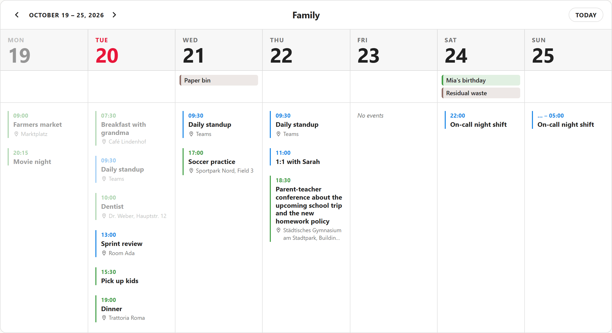
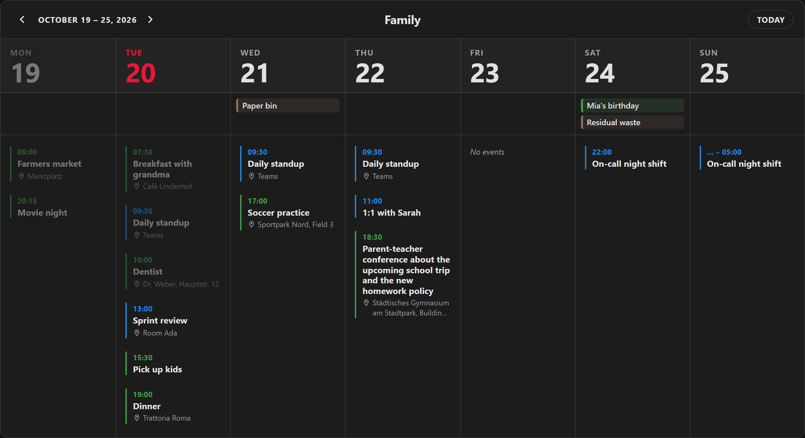
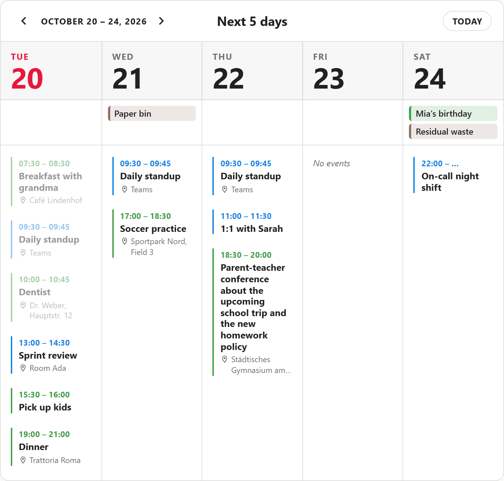
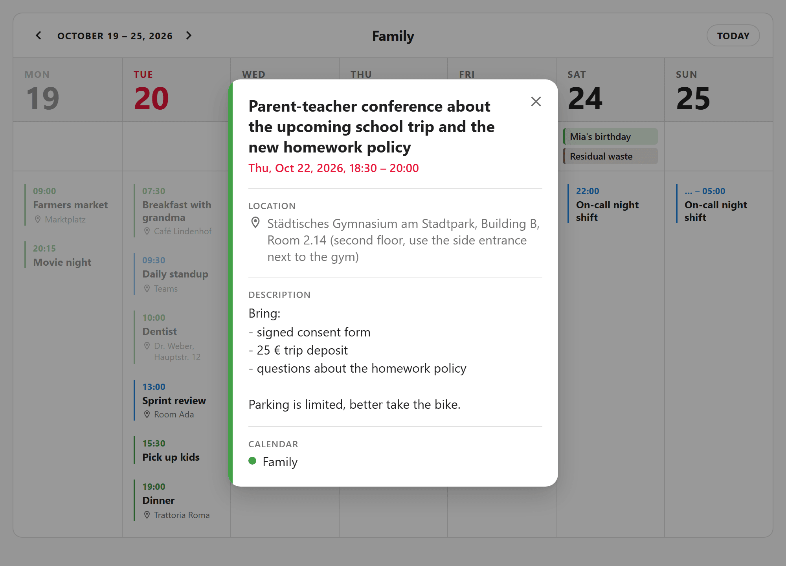
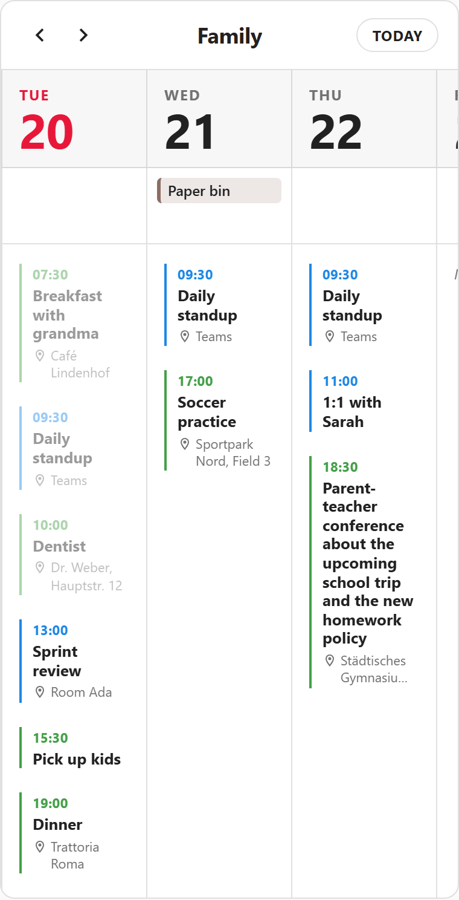

# Column Calendar Card

A clean week-at-a-glance calendar for Home Assistant dashboards: one column per day, events listed top to bottom, all-day events in a strip above.

[](https://hacs.xyz/docs/faq/custom_repositories/)
[](https://github.com/tlanfer/ha-column-calendar/releases/latest)
[](LICENSE)
[](https://www.home-assistant.io/)





## Features

- **Day columns** for any number of `calendar.*` entities, merged and sorted by start time.
- **Week view** (configurable first weekday) or **rolling N days** starting today.
- **All-day strip** with colored chips; multi-day events repeat per day with a "Day 2/5" hint.
- **Per-calendar colors and names**, auto-assigned from a palette when omitted.
- **Today highlighted**, past days and finished events dimmed, automatic rollover at midnight.
- **Navigation** (previous / next / today) that snaps back to the current period after a while.
- **Event details dialog**: tap an event to see time, location, description and calendar.
- **Live updates** via Home Assistant's `calendar/event/subscribe` push API, no polling.
- **Light and dark themes** through Home Assistant theme variables, plus a configurable accent color.
- **Responsive**: columns share the width, narrow cards scroll horizontally, fixed heights scroll per column.
- **Sections view** support including `grid_options.rows`.
- **Visual editor** for calendars and all options.
- Follows your **user profile**: time zone, 12/24 h format, first weekday, language (English, German).

| Rolling 5 days with end times              | Event details                                   |
| ------------------------------------------ | ----------------------------------------------- |
|  |  |

## Requirements

- Home Assistant **2026.5** or newer. The card uses the `calendar/event/subscribe` WebSocket API, which older versions don't have.
- At least one [calendar](https://www.home-assistant.io/integrations/calendar/) entity (Local Calendar, Google Calendar, CalDAV, …).

## Installation

### HACS (recommended)

[](https://my.home-assistant.io/redirect/hacs_repository/?owner=tlanfer&repository=ha-column-calendar&category=plugin)

Or manually in HACS:

1. HACS → ⋮ → **Custom repositories**.
2. Add `https://github.com/tlanfer/ha-column-calendar` with type **Dashboard**.
3. Install **Column Calendar Card** and reload the browser.

HACS registers the dashboard resource for you.

### Manual

1. Download `column-calendar-card.js` from the [latest release](https://github.com/tlanfer/ha-column-calendar/releases/latest) and copy it to `/config/www/`.
2. Settings → Dashboards → ⋮ → **Resources** → **Add resource**: URL `/local/column-calendar-card.js`, type **JavaScript module**.
3. Reload the browser.

When updating manually, append a version query to the resource URL (e.g. `/local/column-calendar-card.js?v=2`) and bump it so browsers fetch the new file.

## Configuration

Add the card from the card picker (search for "Column Calendar") and configure it in the **visual editor**: add, reorder, color, rename and remove calendars, and set all general options. The editor only writes options you change and leaves other keys such as `grid_options` or `visibility` untouched.

Everything is also available in YAML.

### Card options

| Name               | Type                          | Default    | Description                                                                    |
| ------------------ | ----------------------------- | ---------- | ------------------------------------------------------------------------------ |
| `type`             | string                        | _required_ | `custom:column-calendar-card`                                                  |
| `entities`         | list                          | _required_ | Calendars to show: `calendar.x` strings or [entity objects](#entity-options).  |
| `mode`             | `week` \| `rolling`           | `week`     | Calendar week, or N days starting today.                                       |
| `first_day`        | `auto` \| `monday` … `sunday` | `auto`     | Week mode: first day of the week. `auto` follows your user profile / language. |
| `days`             | number                        | `7`        | Rolling mode: number of columns including today.                               |
| `title`            | string                        | –          | Card title.                                                                    |
| `show_range`       | boolean                       | `true`     | Show the visible date range in the header.                                     |
| `show_navigation`  | boolean                       | `true`     | Show previous / next / today buttons.                                          |
| `navigation_reset` | number (seconds)              | `120`      | Return to the current period after this many idle seconds. `0` = never.        |
| `show_end_time`    | boolean                       | `false`    | Show end times of timed events.                                                |
| `show_location`    | boolean                       | `true`     | Show event locations (clamped to two lines).                                   |
| `show_empty`       | boolean                       | `true`     | Show a "No events" placeholder on empty days.                                  |
| `min_column_width` | number (px)                   | `120`      | Minimum column width; narrower cards scroll horizontally.                      |
| `accent_color`     | CSS color                     | `#e8173a`  | Highlight color for today and fallback time color.                             |
| `height`           | CSS length                    | auto       | Fixed card height, e.g. `500px`; each column then scrolls vertically.          |

### Entity options

Each item in `entities` is either a plain entity id (`calendar.family`) or an object:

| Name     | Type      | Default                   | Description                              |
| -------- | --------- | ------------------------- | ---------------------------------------- |
| `entity` | string    | _required_                | A `calendar.*` entity id.                |
| `color`  | CSS color | palette color by position | Time label and event bar color.          |
| `name`   | string    | entity's friendly name    | Calendar name shown in the event dialog. |

The default palette is blue, green, orange, purple, cyan, red, yellow, brown, assigned by position in the list.

## Examples

### Minimal

```yaml
type: custom:column-calendar-card
entities:
  - calendar.family
```

### Week with colored calendars

```yaml
type: custom:column-calendar-card
title: Family
first_day: monday
entities:
  - entity: calendar.family
    color: '#43a047'
  - entity: calendar.work
    color: '#1e88e5'
    name: Work
  - entity: calendar.trash
    color: '#8d6e63'
    name: Trash pickup
```

### Rolling 5 days

```yaml
type: custom:column-calendar-card
title: Next 5 days
mode: rolling
days: 5
show_end_time: true
entities:
  - calendar.family
  - calendar.work
```

### Wall panel with fixed height

A compact, non-interactive view for a wall tablet: fixed height, no navigation.

```yaml
type: custom:column-calendar-card
height: 600px
show_navigation: false
show_range: false
min_column_width: 140
entities:
  - calendar.family
  - calendar.work
```

### Sections view

By default the card grows with its content. Set a numeric `rows` to make it fill the grid cell exactly; columns then scroll vertically.

```yaml
type: custom:column-calendar-card
entities:
  - calendar.family
grid_options:
  columns: 12
  rows: 6
```

## Behavior

- **Navigation**: previous / next move by one period (7 days in week mode, `days` in rolling mode). **Today** jumps back. After `navigation_reset` seconds without interaction, and on every reload, the card returns to the current period.
- **Time zone, 12/24 h and first weekday** follow your Home Assistant user profile (Profile → General). With time zone "server", times are shown in the zone configured for your Home Assistant instance.
- **All-day events** appear as chips in the strip below the column headers. Multi-day events repeat in every column they cover, with a "Day n/m" hint after the first day. Timed events that cross midnight appear on every day they touch.
- **Dimming**: past days and events that have already ended are dimmed; today is highlighted with the accent color.
- **Width**: columns share the available width equally but never shrink below `min_column_width`. On narrow screens the card scrolls horizontally and keeps today in view.

  

- **Height precedence**: numeric `grid_options.rows` (sections view) > `height` > automatic (fits the busiest column).
- **Event dialog**: tap or click an event (timed or all-day) to open a read-only dialog with title, date and time, location, description and calendar.
- **Errors**: if a calendar fails to load, the card shows a warning in the header and keeps showing the other calendars.

## Theming

The card uses the standard Home Assistant theme variables, so it adapts to light, dark and custom themes:

| Variable                                           | Used for                                |
| -------------------------------------------------- | --------------------------------------- |
| `--ha-card-background` / `--card-background-color` | Card and dialog background              |
| `--primary-text-color`                             | Titles and day numbers                  |
| `--secondary-text-color`                           | Weekday labels, locations, placeholders |
| `--divider-color`                                  | Column and row dividers                 |
| `--ha-card-border-radius`                          | Card corners                            |
| `--ha-font-family-body`                            | Font                                    |
| `--warning-color`                                  | Calendar load warnings                  |

The header row shading is derived from the card background with `color-mix()`. Use `accent_color` to change the highlight for today:

```yaml
type: custom:column-calendar-card
accent_color: '#8e24aa'
entities:
  - calendar.family
```

## Development

Requires Node.js 22+.

```sh
npm install
npm run dev        # dev harness with mocked hass and generated events
npm test           # unit + component tests (Vitest)
npm run lint
npm run typecheck
npm run build      # -> dist/column-calendar-card.js
npm run deploy     # build + copy into HA_WWW_DIR
```

`npm run dev` opens `dev/index.html`, which shows several card variants, the visual editor (with native fallback inputs, since `ha-form` and `ha-entity-picker` only exist inside Home Assistant) and the resulting config. URL parameters:

| Parameter               | Effect                                             |
| ----------------------- | -------------------------------------------------- |
| `?theme=dark`           | Dark theme                                         |
| `?lang=de`              | German UI                                          |
| `?tf=12` / `?tf=24`     | 12 / 24 h time format                              |
| `?first=sunday`         | First weekday of the mocked user profile           |
| `?error=calendar.trash` | Simulate a failing calendar (comma-separated list) |
| `?push=30`              | Re-push events every 30 seconds                    |

`dev/screenshots.html` renders a single card without harness chrome (`?shot=week|rolling|narrow`); it is used for the README screenshots.

### Deploying to a test instance

Create a `.env` (see [`.env.example`](.env.example)) pointing at your Home Assistant `www` folder, e.g. a mounted Samba share:

```sh
HA_WWW_DIR=//homeassistant/config/www/community/ha-column-calendar
```

`npm run deploy` builds, copies the file and prints the matching resource URL with a cache-busting `?v=<timestamp>` query. Update the dashboard resource to that URL after each deploy and hard-reload the browser.

## License

[MIT](LICENSE)
